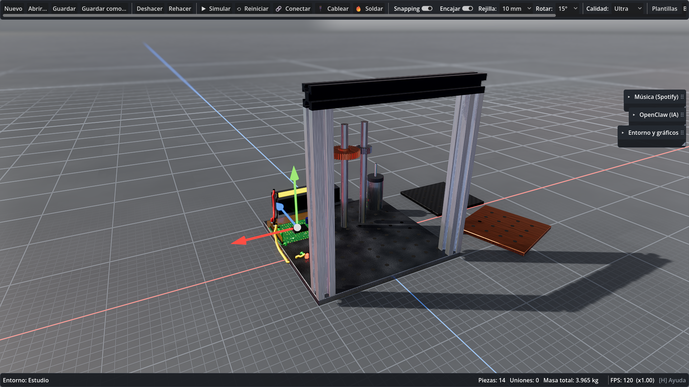
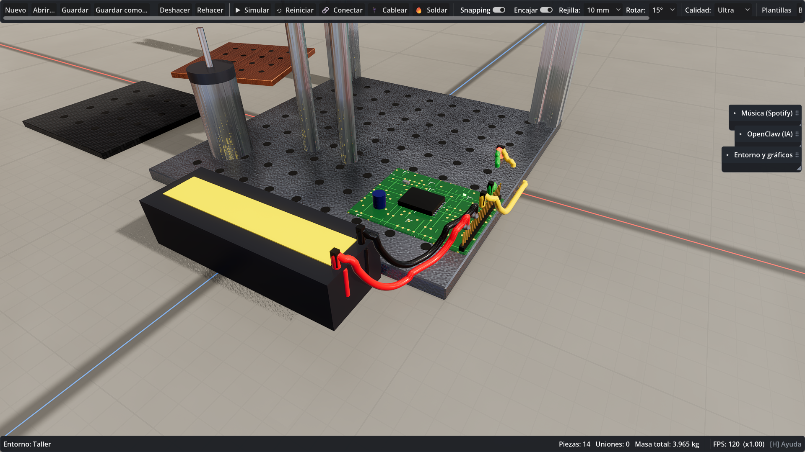
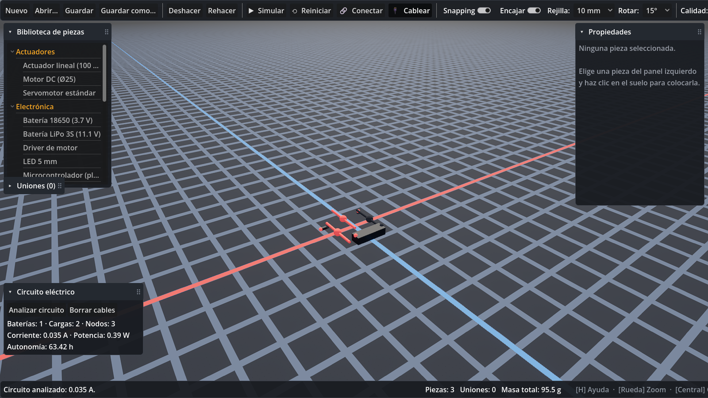
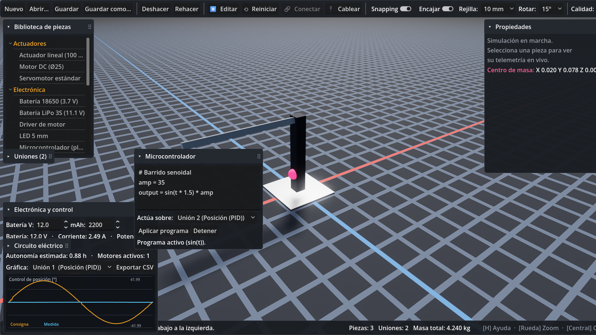
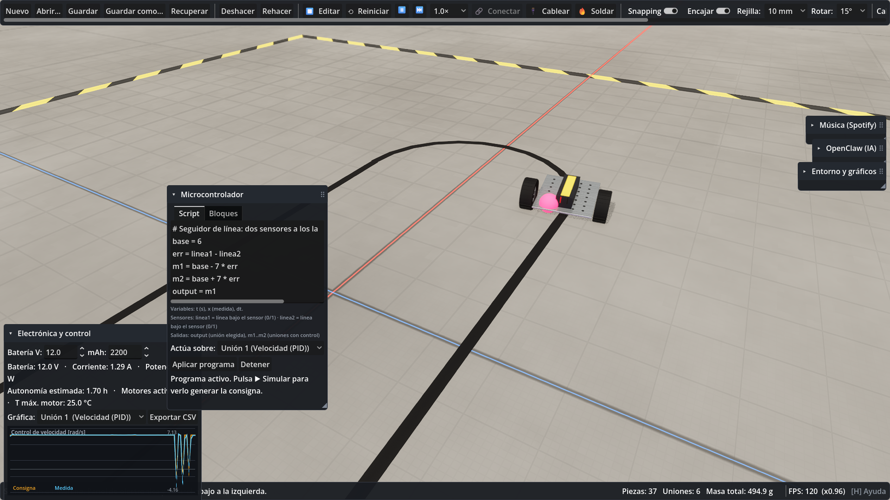
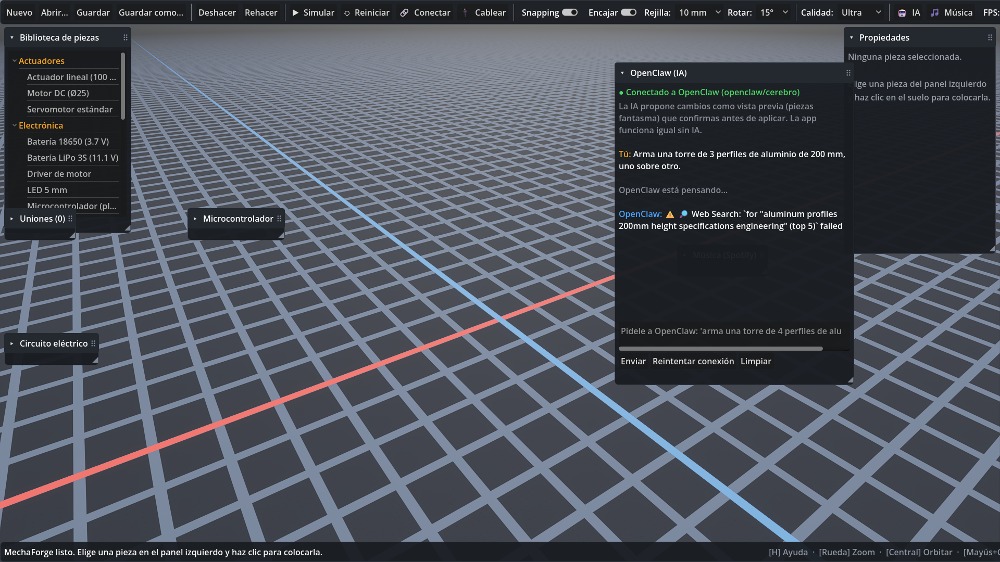

# MechaForge

**Simulador virtual de construcción mecatrónica e ingeniería** — un "sandbox de
ingeniería" para diseñar, ensamblar, programar y probar mecanismos, robots,
vehículos, grúas, estructuras, transmisiones y sistemas de control, con física
realista y gráficos de alta calidad.

> Estado: **todas las fases (1–6) completadas**: construcción, física, electrónica y
> control (script y bloques, sensores), integración con OpenClaw (chat + API de
> herramientas), análisis, refactor gráfico (HDRI, PBR procedural, ranuras en T),
> gizmo 3D, encaje inteligente, cables con física, soldadura, engranajes dinámicos,
> plantillas (brazo 4 GDL, seguidor de línea) y versión portable.
> Ver [docs/HOJA_DE_RUTA.md](docs/HOJA_DE_RUTA.md).


*Estudio (HDRI procedural): bastidor de perfiles 2020 con ranura en T sobre placa perforada, tren de engranajes Z20/Z40, PCB y gizmo 3D.*


*Taller: cables con física (catenaria, sin atravesar piezas), conectores Dupont, PCB con chip y tira de pines, fibra de carbono.*


*Fase 1 — construcción.*


*Fase 2 — simulación física: brazo motorizado, centro de masa (esfera rosa) y telemetría.*


*Fase 3 — control PID de posición con gráfica en vivo y panel de consumo/autonomía.*


*Fase 3.1 — cableado visual (batería + resistencia + LED) y análisis de circuito.*


*Fase 3.1 — microcontrolador programable: el script `sin(t)` genera la consigna que sigue el PID.*

---

## Requisitos

- **Windows 10/11** (probado en Windows 11 Pro).
- **GPU con Vulkan** (Forward+). Probado en NVIDIA GeForce RTX 5060 (8 GB).
- **Godot 4.7.2 — edición .NET/Mono** (incluida en `tools/godot/`).
- **.NET SDK 8** (para los módulos en C#). Verifica con `dotnet --version`.

El proyecto se ejecuta también en GPUs más modestas: los **perfiles gráficos
automáticos** (Bajo/Medio/Alto/Ultra) y el **escalado dinámico de resolución**
ajustan la calidad para mantener los FPS estables.

## Cómo ejecutar

### Opción A — Con el editor de Godot (recomendado para desarrollo)

1. Abre el editor .NET de Godot incluido:
   ```
   tools\godot\Godot_v4.7.2-stable_mono_win64\Godot_v4.7.2-stable_mono_win64.exe
   ```
2. Importa el proyecto: pulsa **Importar** y selecciona
   `project\project.godot`.
3. Pulsa **F5** (Ejecutar) o el botón ▶.

### Opción B — Directo por línea de comandos

```bat
tools\godot\Godot_v4.7.2-stable_mono_win64\Godot_v4.7.2-stable_mono_win64.exe --path project
```

### Modos de verificación (para desarrollo)

- **Benchmark de FPS con 200 piezas** (mide y cierra solo):
  ```bat
  ...\Godot_...mono_win64.exe --path project -- mfbench
  ```
- **Captura de demostración** (renderiza un ensamblaje y guarda un PNG):
  ```bat
  ...\Godot_...mono_win64.exe --path project -- mfshot docs\demo_fase1.png
  ```

## Controles

| Acción | Control |
|---|---|
| Colocar pieza / seleccionar | Clic izquierdo |
| Mover pieza colocada | Arrastrar (X/Z) |
| **Encajar sobre otra pieza** | Arrastrar encima (opción `Encajar`) |
| Mover en altura | Mantener `Z` + arrastrar |
| Ajuste fino por rejilla | Flechas · `Re/Av Pág` (altura) |
| Cancelar / deseleccionar | Clic derecho o `Esc` |
| Orbitar cámara | Botón central del ratón |
| Desplazar (pan) | `Mayús` + botón central |
| Zoom | Rueda del ratón |
| Centrar cámara | `F` |
| Rotar pieza | `R` |
| Eliminar pieza | `Supr` |
| Duplicar | `Ctrl+D` |
| Deshacer / Rehacer | `Ctrl+Z` / `Ctrl+Y` |
| Guardar / Abrir | `Ctrl+S` / `Ctrl+O` |
| Snapping a rejilla | `G` |
| **Simular / detener** | `Espacio` |
| **Conectar dos piezas** | Botón `🔗 Conectar` |
| **Reiniciar simulación** | Botón `⟲ Reiniciar` |
| Ayuda | `H` o `F1` |

Lista completa en [docs/ATAJOS.md](docs/ATAJOS.md).

### Física (Fase 2)

Pulsa **▶ Simular** (o `Espacio`) para activar la física (Jolt, 120 Hz). Las
piezas se vuelven cuerpos rígidos con su masa real, gravedad, fricción y
colisiones. Con **🔗 Conectar** unes dos piezas mediante:

- **Fija** — soldadura rígida.
- **Bisagra** — giro sobre un eje, con límites opcionales y **motor** (curva
  torque–velocidad de motor DC: velocidad objetivo, torque de arranque, velocidad
  sin carga).
- **Deslizadera** — desplazamiento lineal sobre un eje, con límites.
- **Rótula** — giro libre en los tres ejes.
- **Engranaje** — acoplamiento cinemático por relación de transmisión.

Durante la simulación, al seleccionar una pieza se muestra su **telemetría en
vivo** y el **centro de masa** del conjunto (esfera rosa). **⟲ Reiniciar**
devuelve todo al estado inicial exacto.

### Verificación de física
```bat
...\Godot_...mono_win64.exe --headless --path project -- mfphys
```
Ejecuta las pruebas de física (gravedad, reinicio, unión fija, motor, engranaje).

### Electrónica y control (Fase 3)

Al crear una **bisagra con motor**, en el diálogo puedes activar un **control PID**
(posición o velocidad) con su consigna y ganancias Kp/Ki/Kd. Durante la simulación
aparece el panel **Electrónica y control** (abajo a la izquierda) con:

- **Batería** editable (voltaje y capacidad en mAh).
- **Consumo** calculado por el solver eléctrico en C# (corriente, potencia) y la
  **autonomía** estimada.
- **Osciloscopio en vivo** (consigna vs medida) de la unión controlada elegida.
- **Exportar CSV** de la telemetría de control.

### Cableado y microcontrolador (Fase 3.1)

- **🔌 Cablear**: coloca componentes electrónicos (batería, LED, resistencia,
  motor…), entra en modo Cablear y une sus **terminales** (bolas de color) con
  cables. El panel **Circuito eléctrico** analiza el circuito (net-list resuelto
  con el solver en C#): corriente, potencia y autonomía.
- **Microcontrolador**: escribe un programa con variables y funciones
  (`amp = 40`, `output = sin(t) * amp`) que genera la **consigna** de un control
  PID durante la simulación. Variables disponibles: `t` (tiempo), `x` (medida), `dt`.

Pruebas de electrónica y control:
```bat
...\Godot_...mono_win64.exe --headless --path project -- mfelec
```

### Entorno, gráficos y construcción (refactor)

- Panel **Entorno y gráficos**: **Estudio** (softboxes, ideal para ver materiales),
  **Taller** o **Exterior** (cielo físico con **ciclo día/noche**). Puedes añadir tus
  propios **HDRI** (`.hdr`, `.exr`, `.png`) en `%APPDATA%\Godot\app_userdata\MechaForge\hdri`
  y pulsar *⟳ Buscar HDRI*. Antialiasing TAA+MSAA / SMAA / FXAA, bloom, DOF.
- **Gizmo 3D**: selecciona una pieza y arrastra sus flechas (mover) o anillos
  (rotar). `W`/`E` cambian el modo; `R`, `Mayús+R`, `Alt+R` giran en Y/X/Z con pasos
  `1`/`2`/`3` = 15°/45°/90°.
- **Encaje inteligente**: al acercar una pieza a otra se ajusta a orificios, ejes,
  extremos y ranuras en T (anillo verde).
- **Cableado**: los terminales brillan al acercar la punta; cable provisional con
  física; colores por función o personalizados. **🔥 Soldar** anima el cautín y el
  estaño fundiéndose y solidificándose.
- **Engranajes** de la biblioteca (*Transmisión*, Z16–Z60 módulo 1): al unir dos
  con 🔗 *Conectar* se rellenan sus dientes; configura **huelgo** y **rendimiento**.

Pruebas del refactor:
```bat
...\Godot_...mono_win64.exe --headless --path project -- mfrefactor
```

### Microcontrolador: bloques, sensores y varios actuadores

El panel **Microcontrolador** tiene dos pestañas: **Script** y **Bloques** (tipo
Scratch: *Fijar*, *Si/si no*, *Onda*, *Escalón*, *Seguir sensor*, *Limitar*,
*Motor n*, *Salida*; pulsa *Generar script desde bloques*). Los sensores de la
escena aparecen como variables: `dist1` (ultrasonido), `lidar1`, `enc1`,
`imu1_pitch`/`imu1_roll`, `fin1` (final de carrera), `fuerza1`, `linea1` (IR).
Además de `output`, las variables `m1`, `m2`… fijan la consigna de cada unión con
control, en orden. Plantilla de ejemplo: **Carro seguidor de línea**.


*Carro seguidor de línea: dos sensores IR, control diferencial de velocidad y el programa del microcontrolador.*

### Simulación: pausa, paso a paso y cámara lenta

Durante la simulación: `⏸`/`P` pausa, `⏭`/`.` avanza un paso físico (1/120 s) y el
selector de velocidad da cámara lenta (0.5×, 0.25×, 0.1×). El panel de electrónica
muestra también la **temperatura estimada de los motores**. Cada pieza puede
**anclarse al mundo** (casilla en Propiedades) para bancos de prueba o pistas.

### API para OpenClaw (herramientas)

Además del chat, MechaForge expone una **API local JSON-RPC** en
`http://127.0.0.1:18790` (token en `%APPDATA%\Godot\app_userdata\MechaForge\mechaforge_api.json`)
con las herramientas `get_scene_state`, `add_part`, `connect_parts`, `set_property`,
`remove_part`, `write_controller_script`, `run_simulation`, `stop_simulation`,
`get_telemetry` y `analyze_design`. Todo cambio llega como **vista previa** y lo
confirmas tú. La *skill* para OpenClaw está en `openclaw_skill/mechaforge/`
(cópiala a `~/.openclaw/skills/` para activarla).

### Autoguardado

Cada 2 minutos se guarda una copia en `autoguardado.mforge` si hay cambios; el botón
**Recuperar** la abre.

## Versión portable (Windows)

```bat
powershell -ExecutionPolicy Bypass -File tools\empaquetar.ps1 -Zip
```
Genera `dist\MechaForge_portable\` (y un `.zip`): doble clic en **MechaForge.vbs**.
Incluye el runtime de Godot .NET y el proyecto precompilado; solo requiere el
runtime de **.NET 8**.

## Pruebas

| Suite | Comando (`...\Godot_...mono_win64_console.exe --headless --path project -- <suite>`) |
|---|---|
| Base (Fase 1, IA, BOM, importación) | `mftest` |
| Física | `mfphys` |
| Electrónica y control | `mfelec` |
| Refactor gráfico/construcción/física | `mfrefactor` |
| Detalles finales (API, sensores, bloques, plantillas…) | `mffinal` |

## Arquitectura

Modular por carpetas dentro de `project/`:

| Módulo | Responsabilidad |
|---|---|
| `core/` | Escena, piezas (definidas por datos), materiales, uniones, unidades SI, cálculo (C#) |
| `physics/` | Simulador Jolt: cuerpos rígidos, uniones, motores, engranajes, centro de masa |
| `electronics/` | Solver eléctrico, cableado, física de cables y soldadura |
| `control/` | PID (C#), sensores del microcontrolador |
| `rendering/` | Perfiles gráficos, entorno (HDRI/día-noche), texturas procedurales, mallas, shaders |
| `ui/` | Interfaz, cámara orbital, controlador principal |
| `ai_bridge/` | Puente con OpenClaw (chat) y API local de herramientas |
| `io/` | Serialización de proyectos (JSON) |

Detalle en [docs/ARQUITECTURA.md](docs/ARQUITECTURA.md).

### Piezas definidas por datos

Cada pieza es un objeto JSON en `project/parts/`. **Para añadir una pieza nueva,
crea o edita un `.json`** — no hace falta tocar código. Ejemplo en
`project/parts/estructural.json`.

## Integración con OpenClaw (IA personalizada) — *Fase 4*

MechaForge se conecta a tu **OpenClaw** local (gateway `127.0.0.1:18789`, endpoint
compatible con OpenAI) mediante el módulo desacoplado `ai_bridge`. El puente se
**autoconfigura** leyendo el token de tu `~/.openclaw/openclaw.json` y lo guarda
en `user://openclaw_config.json` (**nunca en el código ni en el repo**).

Botón **🤖 IA** → panel de chat "OpenClaw (IA)":
- **Estado de conexión** y selector de **agente** (cerebro, main, …).
- Escribe peticiones (*"arma una torre de 4 perfiles"*) o preguntas de
  diagnóstico; se envía el **estado real de la escena** como contexto.
- Las propuestas de la IA se muestran como **piezas fantasma** con
  **Aplicar / Descartar** (reversible con deshacer). Conexión **solo local**.
- Si OpenClaw no responde, la app funciona completa y lo indica.


*Fase 4 — chat con OpenClaw conectado (agente cerebro), con el estado de la escena como contexto.*

Detalles en [docs/INTEGRACION_OPENCLAW.md](docs/INTEGRACION_OPENCLAW.md).

## Formato de proyecto

Los proyectos se guardan como JSON legible con extensión `.mforge`
(ver `project/io/ProjectSerializer.gd`).

## Licencia

Proyecto personal. Godot Engine se distribuye bajo licencia MIT.
