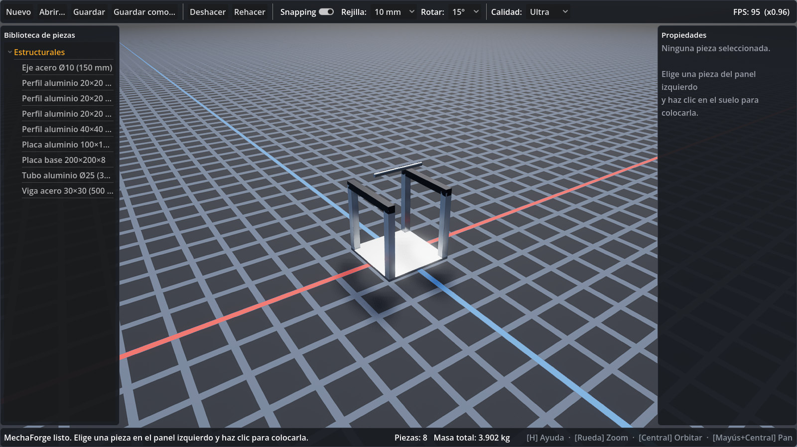
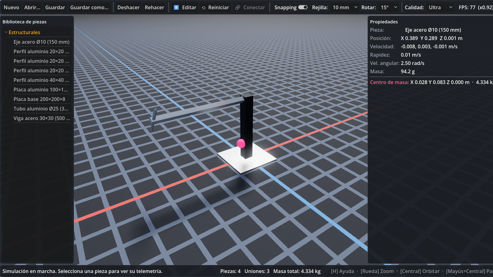
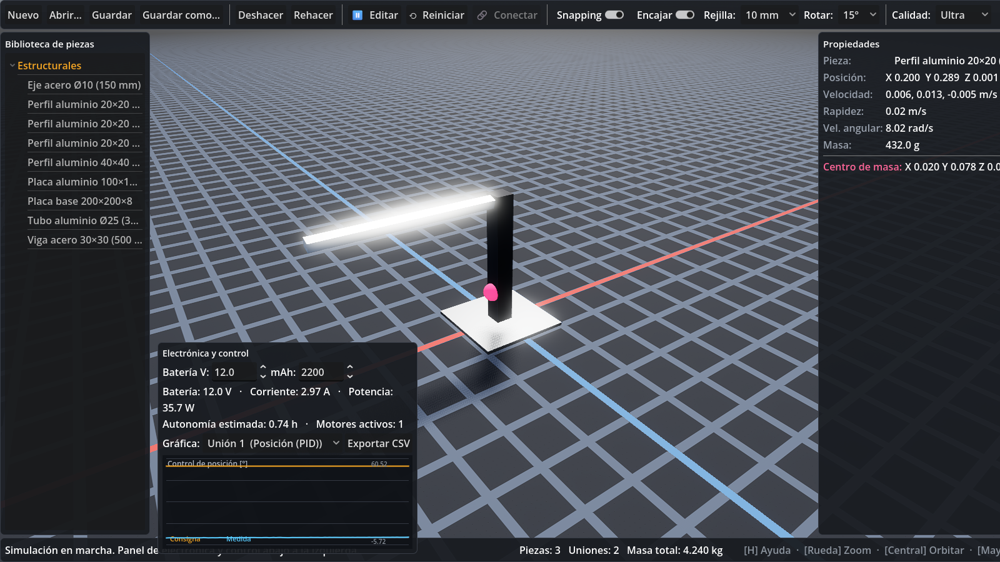

# MechaForge

**Simulador virtual de construcción mecatrónica e ingeniería** — un "sandbox de
ingeniería" para diseñar, ensamblar, programar y probar mecanismos, robots,
vehículos, grúas, estructuras, transmisiones y sistemas de control, con física
realista y gráficos de alta calidad.

> Estado: **Fases 1, 2 y 3 completadas** — construcción (1), **física** (2:
> cuerpos rígidos Jolt, uniones, motores) y **electrónica y control** (3: solver
> eléctrico en C#, PID, gráficas, consumo/autonomía).
> Ver [docs/HOJA_DE_RUTA.md](docs/HOJA_DE_RUTA.md).


*Fase 1 — construcción.*


*Fase 2 — simulación física: brazo motorizado, centro de masa (esfera rosa) y telemetría.*


*Fase 3 — control PID de posición con gráfica en vivo y panel de consumo/autonomía.*

---

## Requisitos

- **Windows 10/11** (probado en Windows 11 Pro).
- **GPU con Vulkan** (Forward+). Probado en NVIDIA GeForce RTX 5060 (8 GB).
- **Godot 4.7.2 — edición .NET/Mono** (incluida en `tools/godot/`).
- **.NET SDK 8** (para los módulos en C#). Verifica con `dotnet --version`.

El proyecto se ejecuta también en GPUs más modestas: los **perfiles gráficos
automáticos** (Bajo/Medio/Alto/Ultra) y el **escalado dinámico de resolución**
ajustan la calidad para mantener los FPS estables.

## Cómo ejecutar

### Opción A — Con el editor de Godot (recomendado para desarrollo)

1. Abre el editor .NET de Godot incluido:
   ```
   tools\godot\Godot_v4.7.2-stable_mono_win64\Godot_v4.7.2-stable_mono_win64.exe
   ```
2. Importa el proyecto: pulsa **Importar** y selecciona
   `project\project.godot`.
3. Pulsa **F5** (Ejecutar) o el botón ▶.

### Opción B — Directo por línea de comandos

```bat
tools\godot\Godot_v4.7.2-stable_mono_win64\Godot_v4.7.2-stable_mono_win64.exe --path project
```

### Modos de verificación (para desarrollo)

- **Benchmark de FPS con 200 piezas** (mide y cierra solo):
  ```bat
  ...\Godot_...mono_win64.exe --path project -- mfbench
  ```
- **Captura de demostración** (renderiza un ensamblaje y guarda un PNG):
  ```bat
  ...\Godot_...mono_win64.exe --path project -- mfshot docs\demo_fase1.png
  ```

## Controles

| Acción | Control |
|---|---|
| Colocar pieza / seleccionar | Clic izquierdo |
| Mover pieza colocada | Arrastrar (X/Z) |
| **Encajar sobre otra pieza** | Arrastrar encima (opción `Encajar`) |
| Mover en altura | Mantener `Z` + arrastrar |
| Ajuste fino por rejilla | Flechas · `Re/Av Pág` (altura) |
| Cancelar / deseleccionar | Clic derecho o `Esc` |
| Orbitar cámara | Botón central del ratón |
| Desplazar (pan) | `Mayús` + botón central |
| Zoom | Rueda del ratón |
| Centrar cámara | `F` |
| Rotar pieza | `R` |
| Eliminar pieza | `Supr` |
| Duplicar | `Ctrl+D` |
| Deshacer / Rehacer | `Ctrl+Z` / `Ctrl+Y` |
| Guardar / Abrir | `Ctrl+S` / `Ctrl+O` |
| Snapping a rejilla | `G` |
| **Simular / detener** | `Espacio` |
| **Conectar dos piezas** | Botón `🔗 Conectar` |
| **Reiniciar simulación** | Botón `⟲ Reiniciar` |
| Ayuda | `H` o `F1` |

Lista completa en [docs/ATAJOS.md](docs/ATAJOS.md).

### Física (Fase 2)

Pulsa **▶ Simular** (o `Espacio`) para activar la física (Jolt, 120 Hz). Las
piezas se vuelven cuerpos rígidos con su masa real, gravedad, fricción y
colisiones. Con **🔗 Conectar** unes dos piezas mediante:

- **Fija** — soldadura rígida.
- **Bisagra** — giro sobre un eje, con límites opcionales y **motor** (curva
  torque–velocidad de motor DC: velocidad objetivo, torque de arranque, velocidad
  sin carga).
- **Deslizadera** — desplazamiento lineal sobre un eje, con límites.
- **Rótula** — giro libre en los tres ejes.
- **Engranaje** — acoplamiento cinemático por relación de transmisión.

Durante la simulación, al seleccionar una pieza se muestra su **telemetría en
vivo** y el **centro de masa** del conjunto (esfera rosa). **⟲ Reiniciar**
devuelve todo al estado inicial exacto.

### Verificación de física
```bat
...\Godot_...mono_win64.exe --headless --path project -- mfphys
```
Ejecuta las pruebas de física (gravedad, reinicio, unión fija, motor, engranaje).

### Electrónica y control (Fase 3)

Al crear una **bisagra con motor**, en el diálogo puedes activar un **control PID**
(posición o velocidad) con su consigna y ganancias Kp/Ki/Kd. Durante la simulación
aparece el panel **Electrónica y control** (abajo a la izquierda) con:

- **Batería** editable (voltaje y capacidad en mAh).
- **Consumo** calculado por el solver eléctrico en C# (corriente, potencia) y la
  **autonomía** estimada.
- **Osciloscopio en vivo** (consigna vs medida) de la unión controlada elegida.
- **Exportar CSV** de la telemetría de control.

Pruebas de electrónica y control:
```bat
...\Godot_...mono_win64.exe --headless --path project -- mfelec
```

## Arquitectura

Modular por carpetas dentro de `project/`:

| Módulo | Responsabilidad |
|---|---|
| `core/` | Escena, piezas (definidas por datos), materiales, uniones, unidades SI, cálculo (C#) |
| `physics/` | Simulador Jolt: cuerpos rígidos, uniones, motores, engranajes, centro de masa |
| `electronics/` | *(Fase 3)* Cableado y solver eléctrico |
| `control/` | *(Fase 3)* Microcontrolador virtual, PID, scripts |
| `rendering/` | Perfiles gráficos, entorno, shaders |
| `ui/` | Interfaz, cámara orbital, controlador principal |
| `ai_bridge/` | *(Fase 4)* Puente con OpenClaw |
| `io/` | Serialización de proyectos (JSON) |

Detalle en [docs/ARQUITECTURA.md](docs/ARQUITECTURA.md).

### Piezas definidas por datos

Cada pieza es un objeto JSON en `project/parts/`. **Para añadir una pieza nueva,
crea o edita un `.json`** — no hace falta tocar código. Ejemplo en
`project/parts/estructural.json`.

## Integración con OpenClaw (IA personalizada) — *Fase 4*

MechaForge se conectará a tu instancia local de **OpenClaw** (gateway en
`127.0.0.1:18789`, endpoint compatible con OpenAI y bridge MCP) mediante un
módulo desacoplado `ai_bridge`. La dirección, puerto y token irán en
`project/ai_bridge/openclaw_config.json` (plantilla en
`openclaw_config.example.json`), **nunca en el código**. La app funciona
completa sin IA; la integración es opcional. Ver
[docs/INTEGRACION_OPENCLAW.md](docs/INTEGRACION_OPENCLAW.md).

## Formato de proyecto

Los proyectos se guardan como JSON legible con extensión `.mforge`
(ver `project/io/ProjectSerializer.gd`).

## Licencia

Proyecto personal. Godot Engine se distribuye bajo licencia MIT.
