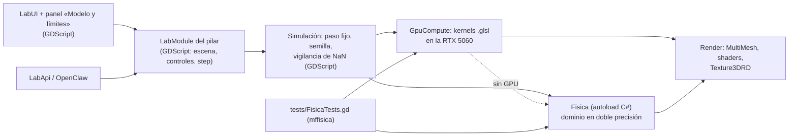

# Física moderna en el Laboratorio: propuesta de arquitectura (Fase 1)

Simuladores de **partículas y mecánica cuántica** y de **teoría de cuerdas** dentro del
Laboratorio matemático de MechaForge (Godot 4.7 .NET), según
`prompt-simuladores-fisica-robusto.md`. Estado: arquitectura **aprobada**; Fases 2 (núcleo), 3 (hidrógeno y partículas) y 4 (módulo 1 completo) **hechas**.

## 1. Decisiones

| Tema | Decisión | Alternativa descartada y por qué |
|---|---|---|
| Dónde | Pilar nuevo «Física moderna» (`MathLab.PILLARS[4]`) con varios `LabModule` | App web aparte: proyecto nuevo, sin la UI, la API de OpenClaw ni las pruebas existentes |
| Partición | El «módulo 1» del encargo son 3 módulos del Laboratorio (`hidrogeno`, `particulas`, `bateria`) y el «módulo 2» son 2 (`cuerdas`, `compactas`) | Un único módulo con modos: un panel de controles inmanejable |
| Carga diferida | La que ya existe: `MathLab.open_module()` hace `load()` del script al abrirlo; los kernels de GPU se compilan en `setup()` | — |
| Física (dominio) | C# puro sin nodos ni escena en `mathlab/fisica/dominio/`, en doble precisión, con funciones sin estado (arrays de entrada y de salida) detrás de un autoload `Fisica` (C# `Node`), como `Electronics` y `MeshTools` | Objetos `RefCounted` de C# por simulación: hay que liberarlos a mano (fallo de cierre de la 0.4.0) |
| Cálculo pesado | **GPU (RTX 5060) con compute shaders de `RenderingDevice`**: GLSL en `.glsl` (`#[compute]`) que Godot importa como `RDShaderFile`. Medido: Coulomb O(N²) con 10 000 cargas en **0,92 ms**, error 1,7·10⁻⁶ frente a doble precisión | Solo CPU: el mismo cálculo tarda ~3,6 s en GDScript y decenas de ms en C# en paralelo |
| Sin GPU | Cada kernel tiene una versión de referencia en C# (`dominio/`). Sin `RenderingDevice` (pruebas sin ventana o renderizador Compatibility) se usa esa, con menos entidades | Exigir GPU: las pruebas sin ventana no podrían correr |
| GPU → dibujo | Primero `RenderingDevice` local y lectura a CPU (10 000 partículas ≈ 160 KB por frame). Para volúmenes grandes (|ψ|² 128³ ≈ 16 MB) se usa el `RenderingDevice` principal con `Texture3DRD`, sin copia | Siempre sin copia: más complejo (hilo de render) sin necesidad para las partículas |
| Dibujo | `MultiMeshInstance3D` para partículas y cuerdas (sin un nodo por entidad); cuerdas evaluadas en el *vertex shader* a partir de sus modos; |ψ|² con *raymarching* en un shader propio (fase = color, con leyenda y valor en el tooltip para no depender solo del color) | `GPUParticles3D`: menos control de los datos; `FogVolume`: no colorea por fase |
| Unidades | Cuántica en **unidades atómicas** (ħ = mₑ = e = 4πε₀ = 1; 1 Eₕ = 27,211386 eV); partículas en **MeV** y fm; cuerdas en unidades de √α′. Las constantes y conversiones viven en `Unidades.cs` con su fuente (CODATA) | Tipos por magnitud (`Energy`, `Length`…): mucho código para poco riesgo; se usa un sufijo en el nombre (`e_eV`, `r_fm`) y pruebas |
| Datos | Tabla PDG en `fisica/datos/particulas_pdg.json` con masa, carga, espín, color y números B/L, más la cita de cada valor. Se verifican contra la fuente al introducirlos, sin escribir ninguno de memoria | — |

## 2. Capas y flujo de datos



La física (`Fisica`, `dominio/`) no conoce la escena: las pruebas la llaman sin interfaz.
El render solo lee buffers. OpenClaw maneja los controles por `LabApi` sin código extra.

## 3. Contratos

**`LabModule`** (se añaden métodos con valor por defecto; los 16 módulos actuales no cambian):

```gdscript
## [{subsistema, nivel: "exacto"|"aproximado"|"ilustrativo", modelo, ecuaciones, unidades, referencias}]
func fidelidad() -> Array: return []
## Estado guardable (JSON); cargar() devuelve "" o el motivo del rechazo.
func estado() -> Dictionary: return {}
func cargar(_d: Dictionary) -> String: return ""
## {entidades, fisica_ms} para el panel de métricas.
func metricas() -> Dictionary: return {}
## false si el estado tiene NaN o ∞: el laboratorio pausa y avisa.
func finito() -> bool: return true
## Paso fijo en segundos de simulación (0: el paso del fotograma).
func fixed_dt() -> float: return 0.0
## Liberar RIDs de GPU al desmontar.
func liberar() -> void: pass
## Antes de un cambio del usuario (para deshacer); lab.record_undo() guarda estado().
func remember() -> void
```

Cada módulo tiene además `rng` (RandomNumberGenerator), que el laboratorio siembra con
la semilla del panel de métricas al abrirlo y al reiniciarlo.

**`Fisica`** (C#, sin estado; ejemplos):

```csharp
double HydrogenEnergy_eV(int n);                                  // −13,605693 eV / n²
Dictionary Conservation(string[] entrada, string[] salida);         // {ok, viola: [...]}
PackedFloat64Array HydrogenDensity(int n, int l, int m, int res, double size_a0);
PackedFloat64Array SpinChainStep(PackedFloat64Array psi, Dictionary h, double dt);
Dictionary StringSpectrum(string tipo, string contorno, int nMax); // α′M² = N − a
```

**`GpuCompute`** (GDScript): `available() -> bool`,
`kernel(ruta_glsl) -> RID`, `run(kernel, buffers, push_constants, grupos)`, `read(buffer)`,
`liberar()`. Comprueba en la primera ejecución que el kernel coincide con la referencia de C#.

## 4. Estructura

```
project/mathlab/fisica/
  Fisica.cs                 autoload (puente GDScript ↔ C#)
  GpuCompute.gd             RenderingDevice local: kernels, buffers, liberación
  dominio/                  C# puro: Unidades, Particulas (tabla), Conservacion,
                            Hidrogeno, Cornell, Decaimientos, Nucleos, CadenaEspines,
                            Cuerda, Compactas
  datos/particulas_pdg.json
  kernels/*.glsl            coulomb, schrodinger3d, …
  shaders/*.gdshader        nube orbital, cuerda, brana, rejilla espacio-temporal
project/mathlab/modules/    HidrogenoModule, ParticulasModule, BateriaModule,
                            CuerdasModule, CompactasModule
project/tests/FisicaTests.gd   suite mffisica (+ «gpu» con ventana, + «bench»)
```

## 5. Nivel de fidelidad previsto

| Subsistema | Nivel | Modelo |
|---|---|---|
| Orbitales y energías del hidrógeno | Exacto | Solución analítica no relativista (sin estructura fina) |
| Schrödinger 3D de paquetes | Exacto (numérico) | Esquema de Visscher 3D (el del 2D actual), norma conservada con tolerancia medida |
| Fuerzas entre cargas | Aproximado | Coulomb/Lorentz clásicos con suavizado ε, sin radiación |
| Fuerza fuerte | Aproximado | Potencial de Cornell V = −4αₛ/3r + σr |
| Hadronización | Ilustrativo | Formación de pares visual, sin cálculo |
| Decaimientos débiles, α, β, γ | Aproximado | Vidas medias y fracciones del PDG y de tablas nucleares; cinemática simplificada |
| Leyes de conservación | Exacto | Carga, números B y L, energía en cada evento |
| Configuraciones electrónicas | Aproximado | Regla de Madelung con las excepciones tabuladas |
| Estabilidad nuclear | Aproximado | Fórmula semiempírica de Weizsäcker |
| Batería cuántica (N ≤ 12) | Exacto (numérico) | Cadena de Heisenberg: evolución unitaria con hamiltoniano disperso; ergotropía de estado puro ⟨H⟩ − E₀ (E₀ por Lanczos) |
| Cuerda clásica libre (abierta, cerrada, N/D) | Exacto | Desarrollo en modos de la ecuación de ondas |
| Espectro de masas | Exacto (en la teoría libre) | α′M² = N − a (bosónica a = 1; supercuerda NS/R) |
| Dimensiones en un toro | Exacto (en la teoría libre) | Masas de Kaluza-Klein y de enrollamiento |
| Calabi-Yau (quíntica) | Ilustrativo | Proyección de una sección real |
| D-branas | Aproximado/ilustrativo | Condiciones de Dirichlet exactas; la membrana es visual |
| Curvatura del espacio-tiempo y g_s | Ilustrativo | Rejilla deformada por la energía; sin gravedad real |

## 6. Rendimiento

Hardware de referencia: Ryzen 7 5700G, **RTX 5060** (Vulkan 1.4, la usa ya Godot y el
ejecutable), 28 GB, 1080p. Perfil «Bajo»: Radeon integrada o sin `RenderingDevice`.
Objetivos: 60 FPS con 10 000 partículas (Coulomb en GPU < 2 ms) y 1 000 cuerdas de 128
puntos (en el *vertex shader*). Lo mide `-- mffisica bench` en la RTX 5060.

## 7. Riesgos

1. **float32 en la GPU**: tolerancias relativas de ~10⁻⁶; las pruebas de precisión se hacen
   con la referencia de C# en doble y la GPU se compara contra ella.
2. **Sin `RenderingDevice` en las pruebas sin ventana**: la parte de GPU se prueba en una
   pasada con ventana (`-- mffisica gpu`).
3. **Fugas de RIDs de GPU**: `liberar()` al desmontar y la prueba de montar y desmontar 20
   veces cada módulo (ya existe para los módulos con `FieldSim`).
4. **Datos físicos**: cada valor con su fuente; ninguno escrito de memoria.
5. **Alcance de «materia exótica» y de los tipos de cuerda**: se acota a superposiciones de
   modos con su masa calculada; los tipos I/IIA/IIB/heterótica cambian el espectro y las
   condiciones permitidas, no simulan dinámica.

## 8. Fase 2 (núcleo compartido): hecha

`Fisica.cs` con `Unidades`; `GpuCompute.gd` con la prueba de Coulomb GPU frente a C#;
contratos de `LabModule`; panel «Modelo y límites» y panel de métricas del Laboratorio;
paso fijo, semilla y vigilancia de NaN; guardado del módulo abierto en el `.mforge`
(«laboratorio»: módulo, versión y estado, con validación) y deshacer en el Laboratorio;
suite `mffisica`.

Hecho y medido en la RTX 5060: Coulomb con 10 000 cargas (subida, cálculo y lectura)
en **1,22 ms**; la GPU coincide con la referencia en C# (error 1,4·10⁻⁵ de la fuerza
típica). Barra del laboratorio: ⏭ (un paso), ↶ ↷ (deshacer y rehacer), «📐 Modelo» y 📊.

## 9. Fase 3 (vertical mínimo del módulo 1): hecha

- **`hidrogeno`** — orbitales exactos ψₙₗₘ (n ≤ 6) como nube de puntos muestreada de
  |ψ|² (muestreo exacto en C#: inversa de la acumulada en r y θ, φ uniforme), con la fase
  como color (`shaders/nube_orbital.gdshader`, la rueda del laboratorio y los planos de
  corte). Eₙ con y sin masa reducida, ⟨r⟩, nodos y degeneración. Comprobado: E₁ =
  −13,605693 eV, ∫R²r²dr = 1 y ∫|Yₗᵐ|²dΩ = 1 con error ~10⁻¹², ⟨r⟩ numérico frente a la
  fórmula, |ψ₁₀₀(0)|² = 1/π y ⟨r⟩ de 40 000 puntos dentro de 0,3σ.
- **`particulas`** — cargas clásicas (electrones y protones, mₚ/mₑ de CODATA 2022) con
  Verlet de velocidades **entero en la GPU** (`kernels/verlet.glsl` + `coulomb.glsl`, que
  da también la energía potencial de cada carga); los pasos de un fotograma se envían
  juntos y la CPU solo lee las posiciones para dibujar. Presets: plasma neutro (con
  paredes opcionales) y átomo clásico (órbita de Kepler). Comprobado: 10 órbitas con
  deriva de energía 6·10⁻⁷ (GPU) y radio ±2·10⁻⁵ a₀; momento conservado a 3·10⁻⁸.
- **Medido en la RTX 5060** (1920×1080): 10 000 cargas a **72 FPS** con Δt = 0,005
  (≈ 3 pasos por fotograma, física ≈ 12 ms). El kernel de Coulomb es el directo, sin
  memoria compartida: optimizarlo con bloques en memoria compartida queda para la Fase 7.
- Errores encontrados por el camino: los métodos del autoload de C# no tienen tipo para
  `:=` en GDScript (hay que tiparlos); sin la comprobación de que el módulo abierto es el
  pedido, una prueba miraba el módulo anterior cuando el script no compilaba.

## 10. Fase 4 (módulo 1 completo): hecha

La caja de arena pasó a ser un módulo propio (`materia`) y las desintegraciones otro
(`desintegraciones`), en lugar de crecer `particulas`: tres paneles de controles distintos.

- **Datos** (`datos/particulas_pdg.json`, PDG 2026 de pdgLive y `mass_width_2026.txt`):
  6 quarks, 6 leptones, γ, g, W, Z, H y 31 hadrones (85 con las antipartículas, que se
  generan con los canales conjugados); carga, B y espín como enteros (×3, ×3, ×2).
  Núcleos: 17 radiactivos y 33 estables de NUBASE2020 (vida media, modos, fracciones).
- **Conservación** (`Particulas.cs`): carga, B, Lₑ, L_μ, L_τ, energía y paridad de
  fermiones, con el motivo. Los 46 canales de la tabla las cumplen todas (prueba los datos).
- **`desintegraciones`**: cámara de burbujas con cinemática relativista exacta (dos
  cuerpos cerrado; tres o más con GENBOD), vuelo βγcτ·(−ln U), hélices exactas en B,
  cadena de desintegraciones y comprobación del cuadrimomento en cada vértice; ficha de
  cada partícula con buscador.
- **`particulas`**: campo B uniforme (Boris, en la GPU y en C#) y líneas de campo E.
- **`bateria`**: cadena XXZ de hasta 12 espines con cargador resonante; Krylov
  adaptativo (un paso con N = 12 en 7,6 ms), ergotropía global y local, esferas de Bloch.
- **`materia`**: hadrones (color, identificación en la tabla), potencial de Cornell con
  cuerda que se rompe y espectro del charmonio (2S − 1S = 570 MeV con los valores por
  defecto, PDG 589 MeV), núcleos (datos o fórmula semiempírica) que se desintegran,
  átomos e iones (Madelung con las 20 excepciones) y moléculas por valencias.
- Comprobado con límites exactos: Cornell = Coulomb (σ = 0) y = potencial lineal con los
  ceros de Airy (αₛ = 0); batería sin interacción = Nω₀ sin²(gt) (error 3·10⁻¹³); Boris
  = ciclotrón; vuelo medio del π⁺ = βγcτ; fracciones del K⁺ dentro de 2,3σ.

**Límites y lo que no se hizo** (para la Fase 7 o fuera de alcance):
- «Arrastrar y soltar» es «pulsar para añadir» al recipiente.
- Sin desintegraciones de W, Z, H, Σ, Ξ, Ω, D ni B (vidas medias sí; canales no).
- Los rayos γ nucleares se nombran (⁶⁰Co, ¹³⁷ᵐBa) pero no hay esquemas de niveles.
- Sin condensado de Bose-Einstein (Gross-Pitaevskii, opcional en el encargo).
- La fórmula semiempírica falla por décimas de MeV: predice estable el ⁶⁰Fe (real β⁻).
- Molécula = valencias saturadas: no distingue enlaces iónicos y la geometría es de muelles.

## 11. Fase 5 (vertical mínimo del módulo 2): hecha

- **Dominio** (`dominio/Cuerdas.cs`, en doble): cuerda relativista libre en el gauge del cono
  de luz. Degeneraciones por nivel como coeficientes de las funciones de partición
  (bosónica: Π(1 − qⁿ)⁻²⁴; supercuerda: sectores NS con GSO y R en potencias de q^½),
  α′M² (abierta N − 1 y cerrada 4(N − 1) en la bosónica; N_b y 4N_b en la supercuerda),
  qué partícula es cada nivel y la forma clásica X(σ, τ) de un estado coherente con las
  ocupaciones elegidas: abierta N–N (cos nσ), D–D (sin nσ) y cerrada (ondas viajeras a
  derecha e izquierda).
- **`cuerdas`**: «una cuerda» con los cuantos de los 4 primeros modos en dos polarizaciones
  (en la cerrada, derecha e izquierda), su nivel, masa, espín máximo, estados del nivel y
  el espectro; la cerrada con N ≠ Ñ se marca como no física. «Muchas cuerdas»: hasta
  5000 evaluadas en el *vertex shader* (`shaders/cuerdas.gdshader`, una malla de líneas
  compartida y los datos de cada cuerda en `INSTANCE_CUSTOM`), coloreadas por su nivel.
- Comprobado: 1, 24, 324, 3200, 25 650 y 176 256 estados en los niveles 0–5 de la
  bosónica; NS = R nivel a nivel (8, 128, 1152, …: la identidad de Jacobi); 24² = 299 +
  276 + 1 en la cerrada sin masa; la forma cumple ∂²X/∂τ² = ∂²X/∂σ² (residuo 1,4·10⁻³,
  el de las diferencias finitas), X = 0 en los extremos D–D, pendiente nula en los N–N y
  sin salto en la costura σ = 0 = 2π de la cerrada.
- **Medido en la RTX 5060**: 5000 cuerdas vibrando a **120 FPS** (el objetivo era 1000 a 60).

**Límites**: en 3D se ven 2 de las D − 2 direcciones transversales; la forma es la clásica
(un estado coherente), no la función de onda; solo modos n ≤ 4 con 0–3 cuantos. Las
D-branas como objetos, las dimensiones compactas, los tipos I/IIA/IIB/heterótica y g_s son
de la Fase 6.
