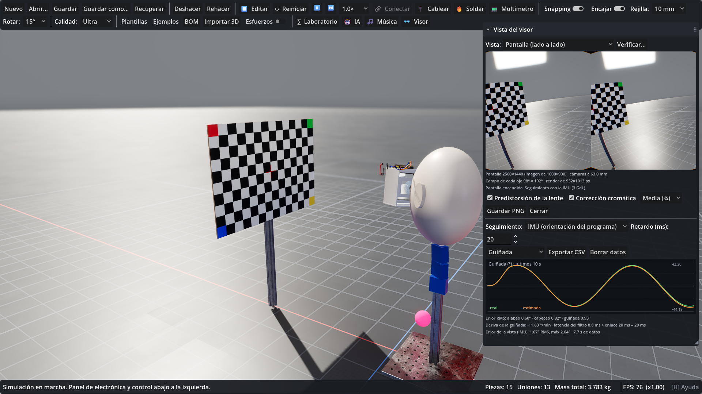

# Gafas VR caseras en MechaForge

Guía para diseñar, montar y probar en el simulador unas gafas de realidad virtual
caseras: carcasa impresa, pantalla, lentes, ESP32 con un MPU-6050 y el render estéreo
que vería quien las lleve. Los dos proyectos de ejemplo («Gafas VR caseras» y «Gafas VR
en cabeza de prueba», menú **Ejemplos**) siguen estos pasos.



## 1. Piezas (categoría «vr»)

| Pieza | Qué es |
|---|---|
| `carcasa_visor` | Carcasa impresa (PLA), abierta por la cara, con hueco para la nariz y pasacables. Colisión y masa de sus paredes |
| `pantalla_55` | LCD 5.5" 2560×1440 con su placa; se enciende con 5 V entre `5V` y `GND`. La cara mira a +Y |
| `movil_61` | Móvil de 6.1" (tipo Cardboard): pantalla siempre encendida, IMU propia y puede correr el programa |
| `lente_cardboard_37` | Lente biconvexa Ø37 mm, f = 45 mm (acrílico, Abbe 57). Eje óptico Y; diámetro, focal y canto editables |
| `lente_fresnel_50` | Lente Fresnel Ø50 mm, f = 50 mm, lámina de 2 mm |
| `soporte_lentes` | Soporte con ranuras para ajustar la distancia entre lentes |
| `esp32_devkit` (electrónica) | ESP32 DevKitC por USB: 5V, 3V3, GND, GPIO21 (SDA) y GPIO22 (SCL) |
| `imu` (electrónica) | Módulo MPU-6050 por I²C (0x68, o 0x69 con AD0) |
| `cabeza_prueba` | Maniquí impreso (elipsoide de 190 × 230 × 150 mm) con los ojos marcados |
| `carta_calibracion` | Tablero de ajedrez A3 con cruz central y esquinas de color |

La pantalla, el soporte y las lentes se colocan con la misma orientación: su +Y mira al
ojo. Con el visor mirando a +X, esa base es `Basis(Vector3(0,0,-1), Vector3(-1,0,0),
Vector3(0,1,0))` (en grados, la que da `get_euler()`).

## 2. Montaje

- **Uniones fijas** de la pantalla, el soporte, la ESP32 y la IMU a la carcasa. En la
  simulación, las piezas unidas con uniones fijas forman un solo cuerpo rígido (con la
  masa, el centro de masa y la inercia del conjunto).
- **Deslizaderas** de cada lente en el soporte, a lo largo de la distancia entre ojos
  (eje Z del mundo si el visor mira a +X), con límites de ±9 mm y **bloqueadas al
  simular**: en edición se ajusta la IPD moviendo la lente; al simular no resbalan.
- La **carcasa anclada** si el visor está sobre la mesa, o fija a la cabeza de prueba.
- **Cables**: ESP32 `5V`/`GND` a la pantalla; ESP32 `3V3`, `GND2`, `GPIO22`, `GPIO21` a
  `VCC`, `GND`, `SCL`, `SDA` de la IMU. El bus I²C comprueba la tensión (3–5.5 V), que
  SDA y SCL no vayan cruzados, el GND común y que no haya dos IMU en la misma dirección.
- Materiales de impresión (PLA, PETG) con relleno y paredes: la masa sale de la
  cáscara más el relleno.

## 3. Firmware (programa del microcontrolador)

```
inicio:
  ok = i2c_escribir(0x68, 0x6B, 0)        # despierta el MPU-6050
  quien = i2c_leer(0x68, 0x75)            # WHO_AM_I = 0x68
bucle:
  ax = i2c16(0x68, 0x3B) / 16384.0        # g (±2 g)
  ay = i2c16(0x68, 0x3D) / 16384.0
  az = i2c16(0x68, 0x3F) / 16384.0
  gx = i2c16(0x68, 0x43) / 131.0          # °/s (±250 °/s)
  gy = i2c16(0x68, 0x45) / 131.0
  gz = i2c16(0x68, 0x47) / 131.0
  r = roll * pi / 180
  p = pitch * pi / 180
  giro = sin(r) * gy + cos(r) * gz
  roll = 0.98 * (roll + (gx + giro * tan(p)) * dt) + 0.02 * atan2(ay, az) * 180 / pi
  pitch = 0.98 * (pitch + (cos(r) * gy - sin(r) * gz) * dt) + 0.02 * atan2(-ax, sqrt(ay * ay + az * az)) * 180 / pi
  yaw = yaw + giro / cos(p) * dt
```

Filtro complementario: integra el giroscopio con la cinemática de los ángulos de
Euler (con el visor inclinado, las velocidades del chip no son las derivadas de los
ángulos) y corrige alabeo y cabeceo con la gravedad que mide el acelerómetro. Ejes del
chip: x adelante, y izquierda, z arriba; alabeo + baja el lado derecho, cabeceo + baja
el frente, guiñada + gira a la izquierda. Las llamadas `i2c_…` se sustituyen por su
valor antes de evaluar la expresión: el programa nunca recibe objetos de la aplicación.

La IMU simula el MPU-6050: ruido, sesgo (distinto en cada pieza), deriva, muestreo a
100 Hz con retención, saturación y cuantización de 16 bits.

## 4. Óptica (lente delgada)

Con la pantalla a d de una lente de focal f (d < f) y el ojo a e de la lente:

- imagen virtual a v = d·f/(f − d) detrás de la pantalla, aumento m = f/(f − d);
- un punto a x del eje se ve con tan θ = x·f / (d·f + e·(f − d)) = s·x;
- el borde de la lente limita el campo a tan α = r/e;
- fuera del eje, distorsión de cojín: el ojo ve en D(t) = t·(1 + k1·|t|² + k2·|t|⁴)
  lo que la lente ideal pondría en t;
- aberración cromática lateral: la escala s cambia ±e·d / (2V·(d·f + e·(f − d))) para
  el azul y el rojo (V, número de Abbe).

Al seleccionar una lente o la pantalla, el panel de propiedades da la distancia, la
imagen virtual, el aumento, el campo por ojo, los píxeles por grado, la IPD y avisos
(pantalla más allá del foco, imagen demasiado cerca, lentes descentradas o desniveladas,
IPD fuera de 54–74 mm).

## 5. Render estéreo (panel 👓 Visor, tecla V)

- Una cámara por ojo sobre el eje de su lente, a la distancia ojo–lente; no ven el
  visor ni las ayudas del editor.
- Frustum asimétrico con lo que ese ojo ve de su mitad de pantalla a través de la
  lente (con la distorsión), recortado por el borde de la lente.
- Un shader compone la imagen lado a lado predistorsionada en barril y con cada color
  en su escala; la lente la devuelve recta. La pantalla del visor la muestra cuando
  está encendida.
- **Vista a través de la lente**: lo que percibe cada ojo (la lente real aplicada a la
  imagen de la pantalla).

## 6. Seguimiento de la cabeza

- **Banco de pruebas**: cabeza impresa sobre tres servos apilados (guiñada, cabeceo,
  alabeo). En las bisagras con control, un **perfil de consigna** (senoidal o
  cuadrado) y la opción **servo ideal** (la pieza sigue el perfil exacto).
- **Modo IMU** del visor: las cámaras siguen la orientación que calcula el programa
  (`roll`, `pitch`, `yaw`) con el retardo del enlace y la pantalla, sin posición
  (3 grados de libertad).
- **Real frente a estimada**: gráfica por eje o del error de la vista, error RMS y
  máximo, deriva de la guiñada (°/min, con la latencia compensada), latencia del filtro
  (el retardo con que la estimada mejor se superpone a la real, sin contar sesgo ni
  deriva) y CSV.

Resultados del ejemplo del banco: RMS de unos 0.8° / 1.2° / 0.9°, latencia del filtro
de unos 9 ms y 1.7–1.9° de error de la vista con 20 ms de enlace. Con solo guiñada, la
deriva es el sesgo del giroscopio en z.

## 7. Verificación (botón «Verificar…», herramienta `check_headset`)

- **Perfil del render**: lo que el programa supone de las lentes (del diseño, manual o
  Google Cardboard v1/v2). Si no coincide con el montaje, aparecen errores.
- Por ojo: desalineación de la imagen, distorsión residual (RMS, máxima y en el borde:
  + cojín, − barril) y aberración cromática residual, en minutos de arco.
- Entre los ojos: la convergencia o divergencia y el desnivel que piden las imágenes,
  en dioptrías prismáticas (Δ = 100·tan θ). Con la imagen virtual a L, una IPD del
  usuario distinta de la de las lentes desvía cada ojo (IPD_lentes − IPD_usuario)/(2L).
  Orientativo: divergencia hasta 1 Δ, convergencia hasta unos 4 Δ, desnivel hasta 0.5 Δ.
- Ergonomía: masa del visor, centro de masa respecto del apoyo en la frente y la
  nariz, y el par hacia delante (orientativo: ≤ 350 g ligero, ≤ 550 g aceptable;
  ≤ 0.15 N·m bien, ≤ 0.35 N·m aceptable).
- Holguras: lente–pantalla, pestañas (mínimo unos 8 mm) y contactos o interferencias
  entre las piezas.

## 8. OpenClaw (API local)

| Herramienta | Para qué |
|---|---|
| `add_part`, `set_property` | Piezas, posición, rotación (`rot_deg`), anclaje (`anclada`) y ajustes en `estado`: `ojo_mm`, `i2c_dir`, `impresion`, `imu`, `colision` |
| `connect_parts` | Uniones con `anclaje`, `limites`, `tipo_motor`, `control`, `consigna`, `pid`, `perfil` (`seno`/`cuadrada`, `ideal`) y `bloqueada` |
| `connect_wire` | Cables entre terminales `uid:terminal` (los da `list_parts` / `get_scene_state`) |
| `write_controller_script` | El firmware |
| `configure_headset` | Seguimiento, retardo, perfil del render, IPD del usuario, predistorsión, color y calidad |
| `analyze_headset` | Óptica, cámaras del render y seguimiento |
| `check_headset` | Verificación óptica, ergonomía y holguras |
| `capture_headset_view` | PNG de la pantalla o de un ojo a través de su lente |

Los cambios llegan como propuesta con vista previa: el usuario pulsa **Aplicar** o
**Descartar**. Una pieza propuesta no existe (ni tiene uid) hasta que se aplica.

## 9. Límites del modelo

- Lente delgada con distorsión radial y aberración cromática lateral; la vista 3D no
  refracta a través de las lentes (lo hace la vista a través de la lente).
- Seguimiento de 3 grados de libertad (solo orientación), como un visor con una IMU.
- En Jolt, un motor de bisagra entre dos piezas que se mueven no sostiene bien una
  carga encima: el banco usa servos ideales.

## 10. Pruebas

`Godot --headless --path project -- mfvr` (sin `--headless`, también el render real);
`-- mfvr fase3|fase4|fase5` corre solo esa parte. El ejemplo se prueba además en
`mfejemplos`.
